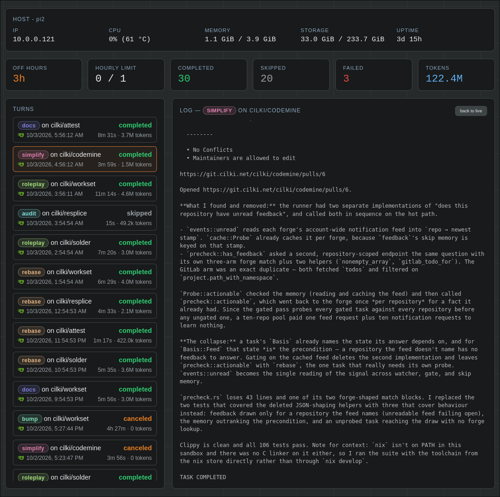

<p align="center">
	
</p>


<hr>

**codemine** runs AI agents on git repos while you're away, delivering tested
PRs and helpful issues.



Each "turn" does one of the following on a repo:

- `respond`: responds to reviewer comments on its open PRs, and opens a PR for
  an issue it's assigned. When a comment or issue asks for another task's job,
  it does that work on the spot, provided the task is ticked for the repository
  and isn't `review` (which gets a turn of its own as soon as it's asked for).
- `rebase`: rebases its own open PR branches that have merge conflicts with
  their base branch, resolving the conflicts and force-pushing — or closes the
  PR and deletes the branch when the change has gone obsolete.
- `review`: reviews a PR when asked — request a review from the bot's account
  on any PR, one of its own included, and it reads the change, comments inline
  on what it finds, and approves or requests changes.
- `bump`: update dependencies, handling any migration issues.
- `simplify`: remove dead code, simplify implementations, drop trivial tests.
- `todo`: handle a TODO comment in the code, or an item from the repo's
  `AGENTS.md` TODO list.
- `roleplay`: run the project like a user would, fixing what breaks along the
  way.
- `benchmark`: run the project like a user would, searching for performance
  improvements.
- `audit`: evaluate the security of the project.
- `docs`: fix outdated docs.
- `coverage`: improve test coverage.
- `mutation`: mutate load-bearing code to find gaps the test suite misses.
- `feature`: propose a new feature as an issue, leaving the call to you rather
  than implementing it.

### Motivation

I wanted an asynchronous process that uses some of my spare tokens to regularly
clean up the code I'm generating "in the foreground". Originally I tried
openclaw, but I found the messaging system unwieldly and annoying. I just want
to check my open PRs once a day, merge anything I think is ready and comment
feedback when the AI is going in the wrong direction.

Further, I wanted a simple web interface that I could use to adjust rate limits
and decide what types of tasks the AI should work on.

I'm running **codemine** on a Raspberry Pi 5 (onboard SSD rather than SD card)
to great success. I tried lesser hardware, but it often became unresponsive
during `cargo test`, `nix-shell`, etc. The pi can only reach my private gitea
instance which I mirror to Github.

### Getting started

Build the image and bring it up with the workspace on a volume; everything that
must survive the container — settings, the skip cache, the proxy login — lives
there. Repository clones live there too, but are recloned fresh on every start,
so one runner owns a workspace: a second **codemine** pointed at the same one
refuses to start rather than clearing the clones and turn logs the running one
is using.

```sh
docker build -t codemine .
docker run -d --name codemine \
  -p 8080:8080 \
  -p 127.0.0.1:54545:54545 \
  -v codemine:/workspace \
  codemine
```

The image pins `TZ=America/Chicago`, and the scheduling window is read against
the container's clock rather than your browser's, so add `-e TZ=<your zone>`
unless that one is already yours — otherwise "22:00 to 06:00" means 22:00 in
Chicago.

The web UI is unauthenticated, and `-p 8080:8080` publishes it on every
interface. Anyone who can reach the port can read the turn logs and rewrite the
settings — which is how forge tokens and the proxy's URL are set — so keep the
published port on a network you trust. `-p 127.0.0.1:8080:8080` confines it to
the host.

The container starts [CLIProxyAPI](#cliproxyapi) alongside **codemine**. Log in
to your AI provider once; the tokens persist on the volume and refresh on their
own from then on:

```sh
docker exec -it codemine cliproxyapi \
  -config /workspace/cliproxyapi/config.yaml -claude-login -no-browser
```

Open the URL it prints in your browser and approve the login. The OAuth callback
lands on port 54545, which is why `docker run` publishes it (loopback only)
above.

Then open http://localhost:8080 and finish up in the settings: pick a model, add
a forge token, and enable some repositories.

### Features

#### CLIProxyAPI

Agents are routed through
[CLIProxyAPI](https://github.com/router-for-me/CLIProxyAPI), which manages the
model subscription. The Docker image runs the proxy itself and the default
settings already point at it (`http://127.0.0.1:8317`); elsewhere, point the
settings page at your own instance. Until the proxy answers, **codemine** stays
unconfigured and runs no turns.

#### Codegraph

With [codegraph](https://github.com/colbymchenry/codegraph) installed, the agent
avoids rereading the tree every turn, which cuts token usage substantially on
large projects.

#### RTK

With [rtk](https://github.com/rtk-ai/rtk) installed, the agent's shell commands
are compressed to save tokens. Hover over the Tokens stat in the web UI to see
how much rtk has saved since startup. rtk estimates these numbers at 4 bytes
per token, so the percentage is reliable but the token counts are approximate.

#### Scheduling and rate limiting

With a schedule enabled, automatic turns — the ones the runner picks for
itself — can only _start_ inside a daily window. Turns the forge asks for (a
review request, or a comment on one of the bot's PRs) start whenever they
arrive, window or not. You can also set a rate limit, which applies to both:
at most _N_ completed tasks in any rolling _W_ hours
(up to 24). Once _N_ tasks have completed inside the window, the next turn
waits until the oldest of them is _W_ hours old. Only turns that make real
changes count; skipped, failed, timed-out and cancelled turns don't. For a
slow rate, widen the window: one task every two hours is 1 per 2h.

A rate limit can't tell whether you've been merging what the bot opens. For
that, set an open-PR budget (1 to 20): while the bot has that many open PRs of
its own on a repository, the tasks that would open another aren't drawn there.
`respond`, `rebase` and `review` keep running, since they work on the PRs
already open, and so does `feature`, which only files issues. Merge or close a
PR and the held-back tasks are drawn again. A custom task that only files
issues can say so with a `<!-- delivers: issue -->` line under its heading.

#### Run now

To take a specific turn rather than wait for the draw, pick a task and an
enabled repository beside the Turns list and press **run now** (or
`POST /api/run` with `{"task": "docs", "repo": "owner/name"}`). The request is
the next turn the runner takes: after the running turn, if any, and once the
rate limit has room, but regardless of the schedule's window. The task doesn't
need to be ticked for the repository, and neither a remembered skip nor the
open-PR budget holds it back, so this is also how to try a new custom task or have a skipped one look
again. A gated task still needs work to act on: `rebase` with no conflicting
PR, say, is dropped with a warning in the log instead of run.

From the command line, `codemine --once --task docs --repo owner/name` runs
exactly that turn and exits, which makes a change to a prompt or a skill easy
to reproduce.

With **Accept commands from the forge** ticked in the settings, you can also
ask from an issue or PR comment, by starting a line with the bot's account and
a task:

    @codemine docs — the "Getting started" section still says port 3000
    @codemine bump

That queues the task on the comment's repository just like **run now**, and
whatever follows the task's name (on that line and the lines after it) is passed
to the turn as what to look at, together with a link back to the comment. The
bot reacts with 👀 and marks the notification read once it has queued the
turn. Only comments from accounts with write access to the repository are
taken. The bot's own comments, quoted lines and code blocks are never read as
commands, and a mention followed by anything that isn't a task's name is left
for `feedback` as ordinary conversation. Commands arrive on the same
notification feed the runner polls once a minute.

#### Forge support

**codemine** works with Gitea, GitHub, or GitLab — one at a time. Pick the forge,
add an access token, and tick the repositories **codemine** should sweep (none by
default). Each repository has its own set of tasks, toggled by clicking the task
labels in its row; the labels along the top turn a task on or off for every
repository at once. A freshly ticked repository starts with every task on.

#### Signed commits

Tick **Sign commits** in the settings and every commit (and tag) a turn makes is
signed with an SSH key **codemine** generates and keeps in the workspace, at
`signing/id_ed25519`. The settings show its public half; register it on the
forge account as a *signing* key so the commits show as verified and can land
on branches that require signed commits. Signing is off by default because
GitHub marks a signature it can't match to the account as *Unverified*. It
needs `ssh-keygen` (OpenSSH) on the `PATH`; when signing can't work, turns are
held and the settings say why.

#### Web interface

You can view and manage the **codemine** instance via a simple web UI on
port 8080. This is where you configure your forge settings, rate limits, select
a model, choose which tasks run on which repositories, view agent logs, etc.

#### What lands

After a turn completes, **codemine** asks the forge which PRs and issues the
bot opened on the repository since the turn started, and links them from the
turn's row. Each one that is still open is checked again about once an hour
until it is merged or closed, and the row colors the link to match. Under the
Turns list a summary shows one line per task: its turns, the PRs it opened and
how many were merged, closed unmerged, or are still open, the issues it opened
(and how many were closed), and the tokens it spent per merged PR. The same
figures are served at `GET /api/deliveries`. They live in `deliveries.json` in
the workspace and survive restarts, unlike the turn list. Anything the bot's
account opens on the repository during a turn counts as that turn's.

Each of those PRs and issues also gets a **turn receipt**: a comment the runner
posts (not the agent) with the model, how long the turn ran, the tokens it
spent, and what rtk saved it, so whoever decides on the change sees its cost
next to it. A PR or issue gets one receipt, from the turn that opened it.
Untick **Post turn receipts on what turns open** in the settings to stop them.

Every PR a turn opens leaves a branch behind. **codemine** deletes the head
branch when that hourly check finds the PR merged, or closed without merging.
The branch is deleted once, when the
PR is first found settled, and is kept if it lives in a fork, is the default or
a protected branch, has commits the PR doesn't have, or is the head of another
open PR. A failed deletion is logged and not retried. The PR page can still
restore a deleted branch, because the forge keeps the PR's commits under its
own ref. Only PRs recorded in `deliveries.json` are covered. Branches of PRs
that settled before then are left alone.

#### Skip caching

A turn that reports nothing to do remembers the state it answered for, and the
task isn't drawn for that repository again until the state moves — or until the
task's own instructions change in a **codemine** upgrade — so a quiet repo
stops costing a session per task to rediscover that it has nothing to do. What
counts as the state is whatever the task reads:

- `simplify`, `benchmark`, `docs`, `coverage`, `mutation`, and `audit` answer
  out of the code alone, so they remember the default-branch commit they last
  found nothing at.
- `respond` answers out of the forge's notification feed, so it remembers the
  newest unread thread it read. The feed doubles as the task's precondition: a
  repository with nothing unread on it isn't drawn for `respond` at all.
- `rebase` answers out of the bot's own open PRs, so it remembers the set of
  conflicting ones. That set is its precondition too — no conflicting PR of its
  own, no turn.
- `review` answers out of the PRs the bot has been asked to review, so it
  remembers the set of pending requests. Same precondition — no pending
  request, no turn — and submitting the review clears the request, so a PR is
  reviewed once per request.

Any other outcome retires the memory instead, since the turn either changed
something (and the state it would be remembered against is stale) or never got
to answer. `bump`, `todo`, `roleplay`, and `feature` can become actionable with
nothing observable moving, so they are never cached. The memory lives in
`skips.json` in the workspace and survives restarts.

Each task declares its basis with a `<!-- cache: … -->` line right under its
heading in `commands/sweep.md` — `head`, `feed`, `prs`, or `reviews`, as above
— and a task without one is never cached. The line is read by **codemine** and
dropped from the prompt the agent sees.

#### Turn notes

Each turn gets a notes file for its task on its repository,
`notes/<forge>/<owner>/<repo>/<task>.md` in the workspace. The agent reads what
earlier turns left there before it starts, and rewrites it before it signs off
with what the next turn should know: what it covered, what it ruled out, the
tools or quirks it ran into. That spares the next turn from rediscovering them.
The notes survive restarts, the way `skips.json` does. **codemine** cuts a file
to its first 8 KiB of whole lines after each turn, so a runaway file can't cost
every later turn the tokens to read it. Delete a file to make the agent forget what it says.

#### Custom tasks

Put your own tasks in `tasks.md` in the workspace, written the way
`commands/sweep.md` writes its own: a `## "slug"` heading per task, followed by
its instructions.

```markdown
## "changelog"
<!-- cache: head -->

- Keep CHANGELOG.md in step with the PRs merged since the last release

## "docs"

- Also check the examples under `examples/` still build
```

A section named after a built-in task appends its lines to that task's
instructions (and replaces its cache basis, if it declares one); any other slug
is a new task, offered in the web UI alongside the built-in ones. New slugs may
only use ASCII letters, digits, `-` and `_`. The same cache lines apply, and
`$2`, `$3` and `$4` are filled in with the repository, the forge, and the clone
just as in the built-in sections. Anything outside a task section is ignored.
The file is read once at startup, so restart **codemine** after editing it; a
file that can't be parsed stops startup rather than being silently dropped.

#### Prioritization

**codemine** doesn't throttle itself. On low-resource machines, lower its
priority where it is started instead; every process it spawns (opencode, cargo,
rustc, test runs, codegraph's indexing) inherits it. Under systemd, add a
drop-in with `systemctl edit codemine`:

```ini
[Service]
Nice=19
IOSchedulingClass=idle
# Or, gentler: best-effort at its lowest level.
#IOSchedulingClass=best-effort
#IOSchedulingPriority=7
```

The web UI runs at the same priority, which it barely notices. I/O priorities
only take effect on schedulers that honor them (e.g. bfq); `Nice=` works
everywhere. In a container, `docker run --cpu-shares` and `--blkio-weight` do
the same job.
